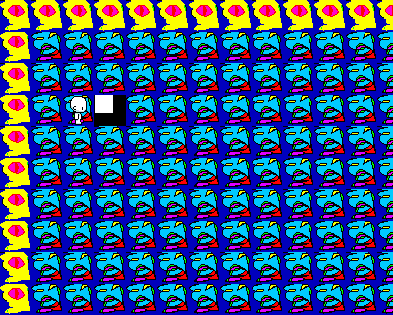
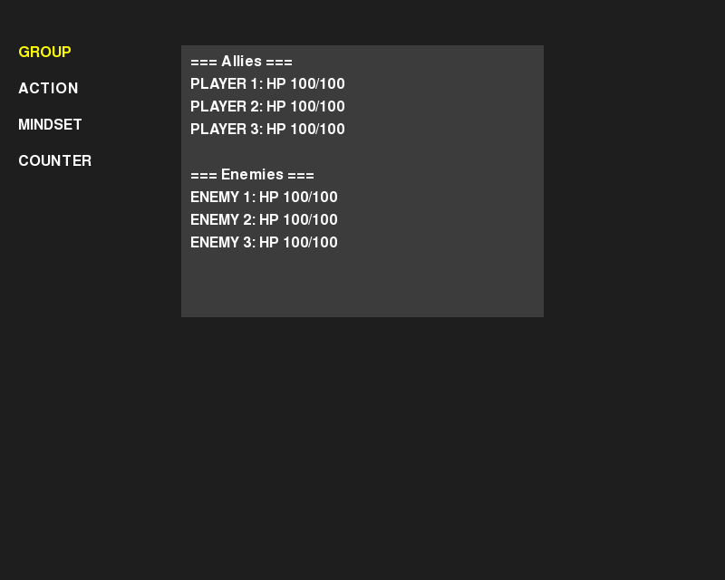
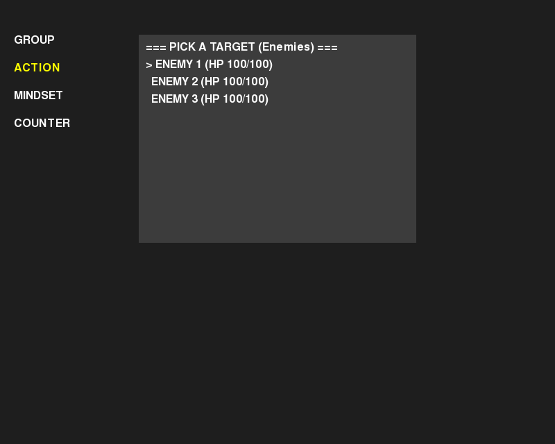

# myRPG

- **Genre:** Turn-based RPG
- **Language(s):** Python 3
- **Libraries/engine:** pygame
- **Coding concepts demonstrated:**
  - Game loop and window stack with focus handling: `main.py`, `window_handler.py`, `windows/window.py`
  - Tile map with collision layers, grid movement with sub-tile interpolation, sprite-sheet walk animation, smoothed and clamped camera: `windows/map_window.py` (first written in `versions/overworld-prototype/main.py`)
  - Turn-based battle state machine and menu navigation: `windows/battle_window.py`
  - Speed-ordered turn timeline (action values, preview by simulation): `battle/turn_log.py`
  - Stat and modifier system (`Num`, `Stat`, `StatLog`): `battle/stats.py`
  - Status effects through subclassing (Poison, Bleed, PowerDown, SpeedDown): `battle/status_effects.py`
  - Battle actions ("arts") and simple enemy AI: `battle/arts.py`, `battle/actors.py`
  - `copy.deepcopy` turn snapshots with custom `__deepcopy__`: `battle/turn_log.py`, `battle/actors.py`
- **Dates:** September 2024 to December 2024 (files dated 2024-12-25 and 2024-12-26)
- **Status:** Prototype. Runs; the overworld leads into a playable battle. Unfinished (see `tasks.md`).

## Screenshots

| Overworld | Battle: group | Battle: action menu |
|---|---|---|
|  |  |  |

## What this is

A pygame prototype that combines a tile-based overworld with a menu-driven turn-based battle. The player walks around a 20x20 map with an animated character and a camera that follows. Facing the special tile and pressing E starts a battle of three party members against three enemies.

Turn order follows speed. Each actor has an action value (1000 / speed) and the lowest one acts next. The battle code also has a stat system with percentage modifiers, damage-over-time effects, and per-turn snapshots made with `deepcopy`. The aim was to learn how to structure a turn-based battle and how to keep the overworld and battle as separate windows.

`versions/overworld-prototype/` holds the earlier version: a single-file overworld with walking and camera, and an empty battle placeholder. The files in the repository root are the later version.

`tasks.md` is the original to-do list. Not done: loading maps from CSV, save files, a history/rewind that uses the turn snapshots, and cleaning up death handling (which was done in several places). The `MINDSET` and `COUNTER` tabs in the battle menu are declared but empty. There is no sound and no battle art.

## Run

Python 3 and pygame are needed.

```
python3 -m venv .venv
source .venv/bin/activate
pip install -r requirements.txt
python main.py
```

Run it from the repository root, since assets are loaded by relative path. For the earlier version, `cd versions/overworld-prototype` and run `python main.py`.

Controls:

- Overworld: W/A/S/D to move, Shift to run, E to interact with the tile in front (the black and white tile starts a battle).
- Battle: W/S (or arrow keys) to move in the menu, E or Enter to select, Esc to go back. Select the ACTION tab, then an art, then a target.

The battle returns to the map when one side has no actors left.

## Credits

Code by Alex Cheng.
